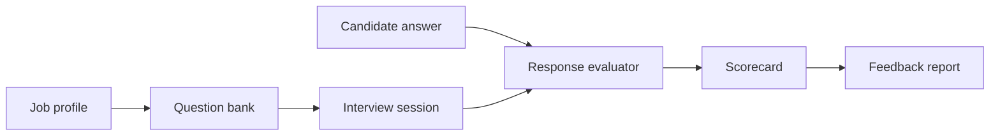

# MockHire — AI Interview Platform

A portfolio reconstruction of an intelligent interview platform that structures interview questions, scores candidate responses against job competencies and produces explainable feedback.

## Features
- role/competency driven interview plans
- deterministic response scoring for reproducible demos
- communication, relevance and evidence signals
- weighted candidate scorecards
- explainable feedback rather than opaque pass/fail output
- automated tests and CI

## Architecture


## Run
```bash
python -m unittest discover -s tests -v
python demo.py
```

## Repository
- `src/evaluator.py` — response feature extraction and scoring
- `src/interview.py` — interview orchestration
- `data/question_bank.json` — sample competencies/questions
- `tests/` — automated validation
- `docs/ARCHITECTURE.md` — system design
- `docs/REPORT.md` — technical project report

## Integrity note
This is a modern portfolio implementation of the project concept, not a claim that these files are the exact archived source of an earlier academic submission. No real hiring decision should rely on this prototype alone.
