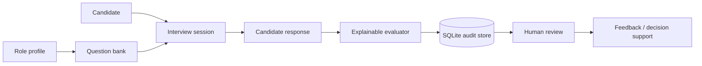

# MockHire — AI Interview Platform

A complete educational portfolio system for structured interview planning, explainable candidate-response scoring, persistence, auditability and human review.

## What this repository contains
- working Python interview and evaluation modules
- SQLite persistence for roles, candidates, questions, sessions, responses and evaluations
- deterministic seed data and sample SQL queries
- architecture, sequence and ER diagrams
- interface/API contracts
- automated unit and storage tests
- GitHub Actions CI
- deployment/runbook notes
- security, privacy and responsible-hiring guidance
- model card and formal technical report

## Core workflow


## Run
```bash
python demo.py
python -m unittest discover -s tests -v
```

## Database
```bash
python -c "from src.storage import init_db; init_db('mockhire.db', seed=True)"
```

The database is local demo infrastructure only; `mockhire.db` is ignored by Git.

## Repository structure
```text
src/                 scoring, orchestration and persistence code
database/            schema, seed and reporting SQL
data/                 sample question bank
tests/                evaluator + database tests
docs/                 architecture, database, API, testing, deployment, security, model card and report
.github/workflows/    CI
```

## Responsible-use boundary
MockHire is decision-support software, not an autonomous hiring authority. Real use would require validated job-related criteria, bias and accessibility testing, candidate notice/consent, retention controls, human review and legal/compliance assessment.

## Integrity note
This is a modern portfolio implementation of the project concept and is not represented as the exact archived source code from an earlier academic submission.
