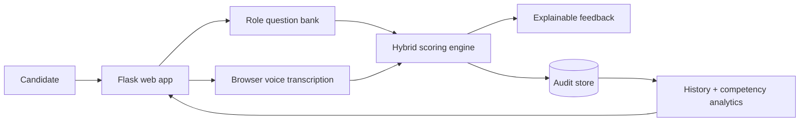

# MockHire — AI Interview Practice Platform

**Status: Active portfolio product**

[](https://github.com/rsswethaa/mockhire-ai-interview-platform/actions/workflows/ci.yml)

**[Live Demo](https://swethaa-mockhire.onrender.com) · [Architecture](docs/ARCHITECTURE.md) · [Security](SECURITY.md) · [Model Card](docs/MODEL_CARD.md)**

## The problem

Interview practice is usually generic: candidates answer a question, but they do not get a consistent view of whether the response was relevant, evidence-based, clearly structured or improving over time.

MockHire turns that into a repeatable practice workflow. A candidate chooses a role, answers competency questions by typing or speaking, receives explainable feedback, and can compare performance across sessions.

## What it does

- role-specific tracks for Finance Analyst, Data Analyst, Business Analyst and Software Engineer
- browser speech-to-text with the Web Speech API
- semantic relevance scoring with optional Sentence-BERT
- deterministic fallback scoring for lightweight/reproducible environments
- STAR structure and evidence analysis
- relevance, clarity and competency feedback
- persistent candidate/session history
- competency trend dashboard
- JSON integration endpoints
- Docker packaging and CI

## Key engineering decisions

### Hybrid semantic scoring

Keyword overlap alone misses paraphrases. Optional Sentence-BERT improves semantic matching, while a deterministic fallback keeps the application usable in CI and resource-constrained deployments.

### Explain the score

The product does not stop at a single number. Feedback is split into dimensions such as relevance, evidence and clarity so the candidate can act on it.

### Persistent history instead of one-off scoring

Sessions and evaluation dimensions are stored so improvement can be analysed over time rather than treating every answer as an isolated request.

### Hiring boundary

MockHire is intentionally positioned as **practice and decision support**, not an autonomous hiring authority. The project does not claim validated prediction of employee performance.

## Architecture



## API

- `GET /api/roles` — role profiles and question banks
- `POST /api/evaluate` — evaluate and persist an interview
- `GET /api/history?candidate=...` — previous sessions and competency summaries
- `GET /health` — service health

## Run locally

```bash
python -m venv .venv
source .venv/bin/activate  # Windows: .venv\Scripts\activate
pip install -r requirements.txt
python app.py
```

Optional semantic model support:

```bash
pip install -r requirements-ml.txt
```

Docker:

```bash
docker build -t mockhire .
docker run -p 5000:5000 mockhire
```

## Data and auditability

The project persists roles, candidates, questions, interview sessions, answers, evaluation dimensions, model version and timestamps. The `database/` directory contains schema/seed/reporting SQL; `docs/DATABASE.md` documents the data model.

## Limitations

- semantic scores are not validated job-performance predictions
- browser speech recognition availability varies by browser/device
- fairness cannot be established merely by excluding protected attributes
- real employment use would require job-related validation, accessibility review, privacy controls, representative outcome testing and human oversight

See [SECURITY.md](SECURITY.md) and [docs/MODEL_CARD.md](docs/MODEL_CARD.md) for the operational and responsible-use boundaries.

## Why I built it

The project combines NLP, product design and analytics around a practical user problem: helping people practise communication in a way that is more structured and measurable than generic interview prompts.
