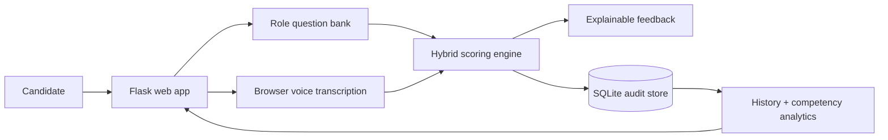

# MockHire — AI Interview Platform

[](https://github.com/rsswethaa/mockhire-ai-interview-platform/actions/workflows/ci.yml)

A product-style AI interview practice platform with role-specific question banks, browser voice transcription, hybrid semantic scoring, STAR feedback, persistent candidate history and competency analytics.

## Why it matters
Interview practice is often generic and inconsistent. MockHire gives candidates a repeatable way to practise against job competencies and see how their evidence, relevance, clarity and STAR structure improve over time.

## Product features
- polished Flask web interface
- Finance Analyst, Data Analyst, Business Analyst and Software Engineer interview tracks
- browser speech-to-text using the Web Speech API
- semantic relevance scoring with optional Sentence-BERT
- deterministic fallback scoring for reproducible CI
- STAR structure analysis
- evidence, clarity and competency feedback
- candidate session history stored in SQLite
- competency trend dashboard
- recruiter/integration-ready JSON endpoints
- Docker packaging and environment configuration
- automated unit, database and end-to-end API tests

## Architecture


## Quick start
```bash
python -m venv .venv
source .venv/bin/activate  # Windows: .venv\Scripts\activate
pip install -r requirements.txt
python app.py
```
Open `http://127.0.0.1:5000`.

### Optional S-BERT semantic scoring
```bash
pip install -r requirements-ml.txt
```
If the model package is unavailable, the application automatically uses a lightweight deterministic semantic proxy.

### Docker
```bash
docker build -t mockhire .
docker run -p 5000:5000 mockhire
```

## API
- `GET /api/roles` — role profiles and question banks
- `POST /api/evaluate` — evaluate and persist a complete interview
- `GET /api/history?candidate=...` — previous sessions and competency summaries
- `GET /health` — service health

## Database and auditability
The SQLite database stores roles, candidates, questions, interview sessions, answers, evaluation dimensions, model version and timestamps. The `database/` folder includes schema, seed data and reporting queries; `docs/DATABASE.md` includes the ER diagram and data dictionary.

## Project structure
```text
app.py               web/API application
templates/, static/   product interface
src/                  scoring, interview and persistence modules
database/             schema, seed and reporting SQL
data/roles.json        role-specific interview bank
notebooks/             scoring exploration
tests/                 core, database and product/API tests
docs/                  architecture, product, API, security, testing, deployment, model card and report
.github/workflows/     CI
```

## What I learned
This project demonstrates NLP product design, explainable scoring, Flask APIs, browser speech integration, SQLite analytics, model fallback design, Docker, CI and responsible-AI documentation.

## Responsible use
MockHire is a practice and decision-support prototype, not an autonomous hiring system. Real employment use requires validated job-related rubrics, bias/fairness testing, accessibility review, consent, privacy controls and human oversight.

## Integrity note
This is a modern portfolio implementation of the project concept, not a claim that these files are an archived copy of an earlier academic submission. No fabricated accuracy or hiring-performance claims are made.
