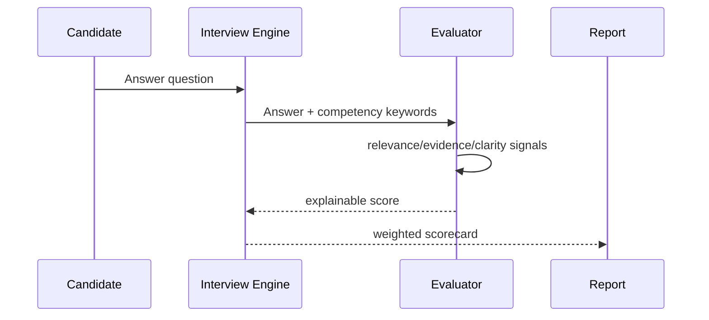

# Architecture

The reference implementation uses transparent lexical/evidence signals so tests are deterministic. A production research version could replace or augment relevance scoring with sentence embeddings or an LLM while retaining auditability and human review.
