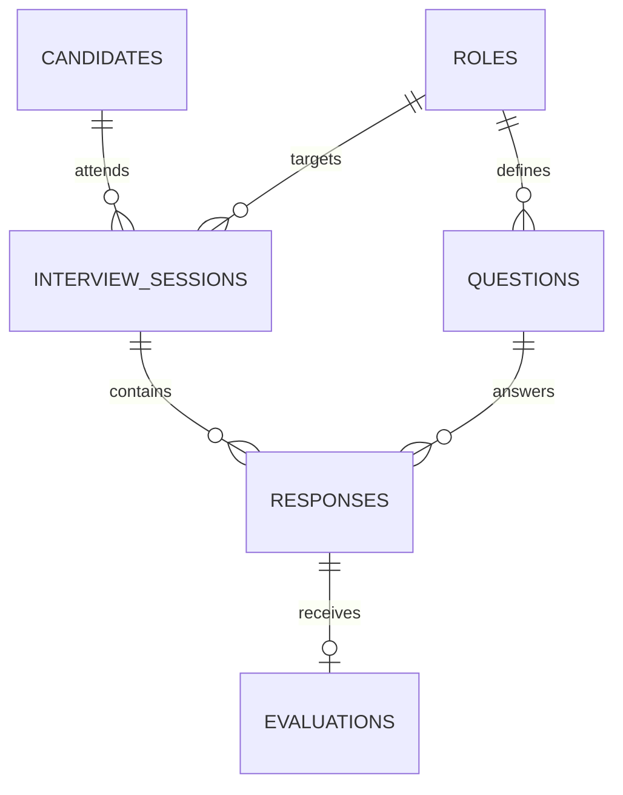

# Database Design

SQLite is used for reproducible local persistence and an auditable interview trail.

## Data dictionary
- `candidates`: pseudonymous candidate reference and optional display name.
- `roles`: target role metadata.
- `questions`: competency-linked interview prompts and weights.
- `interview_sessions`: workflow state and final score.
- `responses`: candidate answer text.
- `evaluations`: explainable component scores, feedback and model version.

## Integrity controls
Foreign keys are enabled. Score ranges use CHECK constraints. Candidate external references and role names are unique. Evaluation rows are one-to-one with responses.

## Privacy note
A production system should minimise stored identity data, encrypt sensitive content, define retention/deletion schedules and tightly restrict access to interview records.
