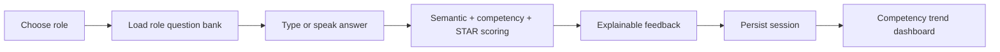

# Product Design

## Business use case
MockHire helps students and early-career applicants practise role-specific interviews before speaking to a recruiter. It standardises practice around competencies, evidence and STAR structure while keeping the final interpretation with the user.

## User flow

## Product surfaces
- Candidate interview screen
- Browser speech-to-text controls
- Question-level feedback cards
- Competency performance bars
- Historical session scores
- JSON API for integrations

## Scoring dimensions
The product combines relevance, evidence, clarity, STAR structure and semantic alignment. When Sentence-BERT is installed the semantic dimension uses `all-MiniLM-L6-v2`; otherwise CI and lightweight demos use a deterministic lexical-semantic fallback.

## What I learned
- turning an ML/NLP concept into an end-to-end product
- designing explainable scoring rather than opaque ranking
- integrating browser speech recognition without requiring a paid API
- persisting model outputs for longitudinal analytics
- separating optional heavyweight ML dependencies from reliable CI

## Next production steps
Authentication, encrypted candidate data, explicit consent, calibrated rubrics, accessibility testing, bias evaluation, recruiter review controls and deployment behind HTTPS.
